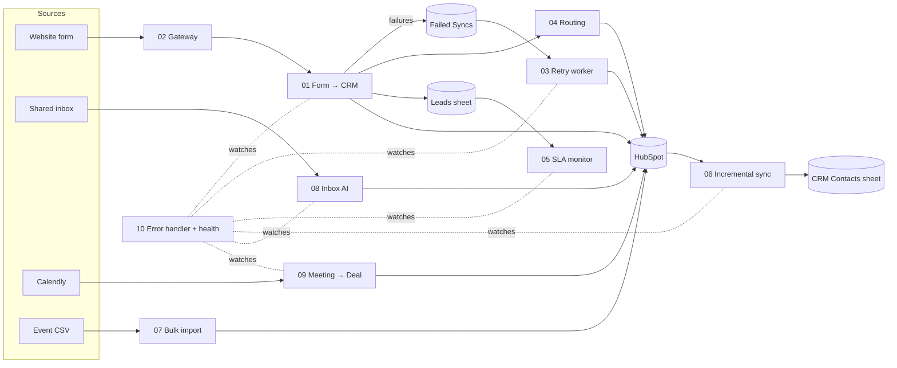

# n8n Automations: Forms → CRM → Google Sheets → Email

Ten n8n workflows built around one everyday business system: website forms and inboxes feeding a **HubSpot CRM**, a **Google Sheet** for tracking and reporting, and **email** notifications to the team.

Each project solves one problem small B2B teams actually have: duplicate contacts, bot submissions, leads lost when an API fails, leads nobody called back, messy event lists, demo bookings that never reach the pipeline. Each folder has a detailed README covering the problem, the design decisions, the data mapping, the error handling and the limitations.

> **Status, stated plainly:** all 11 workflow files are built and importable, and the JavaScript inside every Code node is covered by **59 unit tests** run with realistic sample payloads (`npm test`). **Projects 01, 03, 04, 05, 06 and 07 have been run live** (HubSpot free account, Google Sheets, Gmail SMTP), with screenshots and a "What the live run caught" section in their READMEs; the other projects have **not yet been run against live HubSpot, Google, Calendly or OpenAI accounts**. Time-saved figures are **estimates** with the assumptions written next to them.

## The ten projects

| # | Project | Problem it solves | Key techniques | Est. time saved* |
|---|---|---|---|---|
| 01 | [Form → HubSpot → Sheets → Email](projects/01-form-to-crm-sheets-email) | Copying every form lead into the CRM and a sheet, then forwarding it | Webhook, field aliases, validation, search → update/create, **no-blank-overwrite** + **stage-only-forward** rules, race-safe upsert, Sheets append-or-update | ~10 h/mo |
| 02 | [Secure Webhook Gateway](projects/02-secure-webhook-gateway) | Bots, double submits and forged requests polluting the CRM | **HMAC-SHA256** (raw body, timing-safe, replay window), rate limit per IP, honeypot, weak-signal spam scoring, duplicate fingerprint | ~1 h/mo + clean data |
| 03 | [CRM Retry Queue](projects/03-crm-retry-queue) | Leads silently lost when HubSpot is down or a token expires | **Dead-letter queue**, error classification (permanent / auth / temporary), **exponential backoff + jitter**, escalation | no lost leads |
| 04 | [Lead Routing](projects/04-lead-routing-round-robin) | Manual, slow, unfair lead assignment | Rules in a sheet (territory, segment, out-of-office), **round robin**, existing-owner protection, audit log | ~6 h/mo |
| 05 | [Speed-to-Lead SLA](projects/05-speed-to-lead-sla) | Leads waiting days for a first call | **Business-hours clock** (weekends, holidays, DST), HubSpot activity check before alerting, grouped reminders, escalation levels | ~5 h/mo |
| 06 | [HubSpot → Sheets Incremental Sync](projects/06-crm-to-sheets-incremental-sync) | Stale weekly CSV exports for reporting | **Cursor-based incremental sync**, HTTP **pagination**, dedupe across pages, cursor moved only after a successful write | ~2 h/mo |
| 07 | [Bulk CSV Import](projects/07-bulk-csv-import-dedupe) | Messy event lists, duplicates after import | Header aliases, row-level rejects with reasons, in-file merge, **batch upsert (100)**, rate limiting, 207 partial-failure handling, report email | ~3–6 h/mo |
| 08 | [Inbox → AI → CRM](projects/08-inbox-ai-to-crm) | Real inquiries buried in a shared inbox | IMAP, rules before AI, **OpenAI JSON mode**, prompt-injection defence, **AI output validated in code**, HubSpot note + association | ~7 h/mo |
| 09 | [Calendly → HubSpot Deal](projects/09-meeting-booked-to-deal) | Demo bookings missing from the pipeline; reschedules/cancels never updated | Calendly signature, **idempotency** against webhook retries, reschedule = cancel + create handling, deal ↔ contact association | ~4 h/mo |
| 10 | [Error Handler + Health Report](projects/10-error-handler-health-report) | Failures noticed days later, or alert floods | Central **Error Workflow**, error categories + likely fix, **alert suppression**, n8n API daily report as heartbeat | ~3 h/mo |

\* Assumptions are in each project's README (e.g. 01: 100 leads/month × 6 min). Real numbers should be measured with the team before and after go-live.

## How they fit together



Each workflow also works on its own; the README of each project lists exactly which credentials and sheet tabs it needs.

## Engineering practices used throughout

- **Code in files, not in JSON.** Code-node JavaScript lives in `projects/*/src/*.js` and is built into the workflow JSON by `scripts/build.mjs`. Reviewable, diffable, testable.
- **Unit tests without n8n.** `scripts/harness.mjs` runs a Code-node file with a fake `$input`, `$('Node')`, `$env`, static data and binary helpers. `npm test` runs all 55 tests in under a second.
- **Never lose data.** Red error outputs, retry queues and review tabs instead of dropped items. Every "reject" has a written reason.
- **Respond fast, work after.** Webhooks answer `202`/`200` before slow CRM calls, so form providers and Calendly do not time out and retry.
- **Idempotent writes.** Upsert by email or invitee URI, `appendOrUpdate` by key, so retries and double submits never create duplicates.
- **AI suggests, code decides.** Model output is validated (allowed values, ranges, formats) before it reaches the CRM. Untrusted text is passed as data, not instructions.
- **Escape everything** that goes into HTML emails.
- **Readable canvases.** Every workflow has an overview sticky note, colour-coded stages (green trigger, orange validation, purple CRM/AI, blue output, red failure) and a one-line subtitle on every node.

## Repo structure

```
projects/
  NN-name/
    README.md        problem, design, mapping, error handling, setup, limitations
    workflow.mjs     workflow definition (nodes, connections, sticky notes)
    workflow*.json   built output → import into n8n
    src/*.js         Code-node JavaScript
    tests/*.test.mjs unit tests
    samples/         example payloads / CSVs (where useful)
scripts/
  lib.mjs            node helpers + canvas layout
  build.mjs          src + workflow.mjs → workflow.json
  deploy.mjs         create/update via n8n API, keep credentials, link the error workflow
  harness.mjs        Code-node test runner
docs/SETUP.md        credentials, env vars, every Google Sheet tab and its columns
```

## Quick start

```bash
npm test                       # 55 tests, no n8n needed
npm run build                  # rebuild workflow JSON after editing src/
N8N_URL=http://localhost:5678 N8N_API_KEY=xxx node scripts/deploy.mjs
```

Full setup: [`docs/SETUP.md`](docs/SETUP.md).

## Tech

n8n 2.x · HubSpot CRM API v3 (contacts, deals, notes, search, batch) · Google Sheets · SMTP / IMAP · Calendly webhooks · OpenAI Chat Completions (JSON mode) · JavaScript (Code nodes) · Node.js test runner
