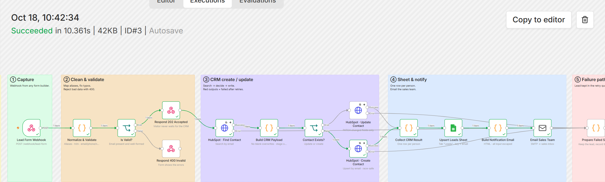
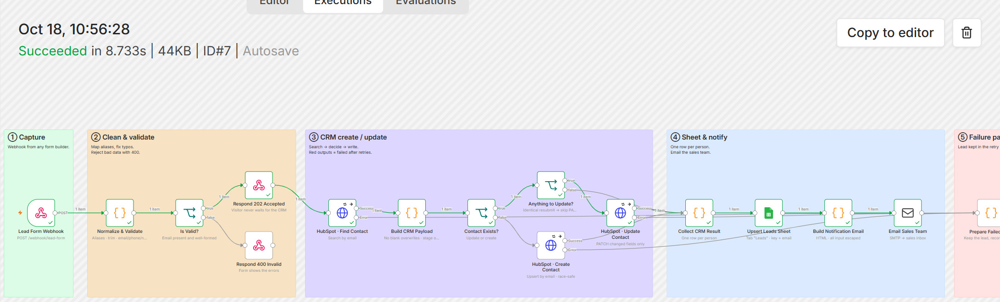
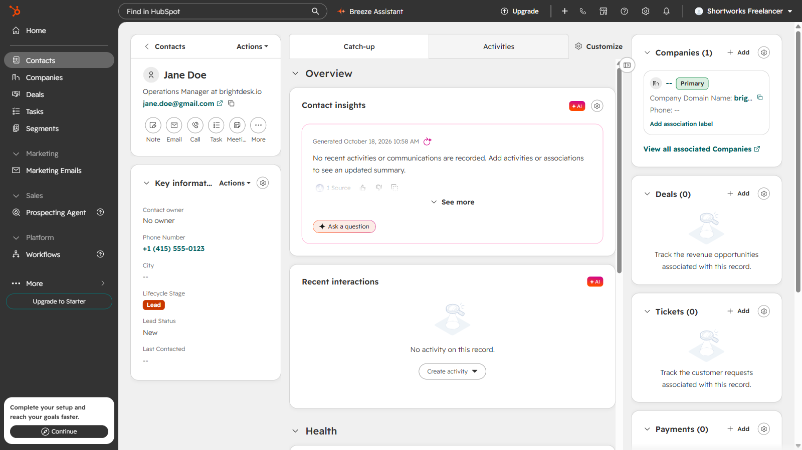
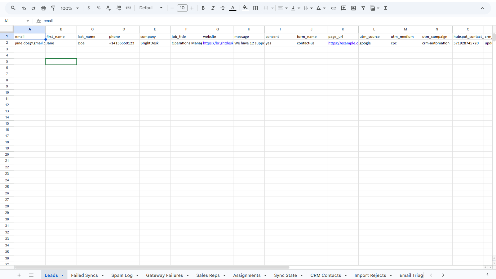
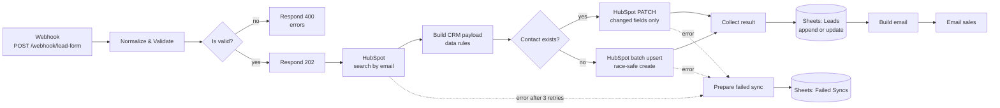

# 01 · Form → HubSpot (create/update) → Google Sheets → Email

> Every website form submission becomes a clean HubSpot contact, a row in a tracking sheet and an email to the sales team, within seconds and without duplicates.

**Status:** **run live on 2026-10-18** on a self-hosted n8n against a HubSpot free account, Google Sheets and Gmail SMTP (create, update and identical-resubmit paths). Code-node logic is also covered by 8 unit tests (`npm test`). The live run surfaced four bugs the unit tests could not catch; they are fixed and listed under [What the live run caught](#what-the-live-run-caught).

| Execution: new contact | Execution: returning contact |
|---|---|
|  |  |

| HubSpot contact | Leads sheet |
|---|---|
|  |  |

---

## The business problem

A typical small B2B team gets leads from a "Contact us" form on the website. Today someone:

1. reads the form email,
2. searches HubSpot to see whether the person already exists,
3. creates the contact or edits the existing one,
4. pastes the lead into a Google Sheet the manager uses for weekly numbers,
5. forwards the email to whoever is on sales duty.

That is about 6 minutes per lead, it only happens during office hours, and it goes wrong in predictable ways: duplicate contacts, typos in emails, an existing customer accidentally reset to "Lead", and leads forgotten in the inbox.

## What this workflow does

| Step | What happens |
|---|---|
| Capture | The form POSTs to an n8n **Webhook**. Works with Webflow, WordPress/Elementor, Typeform, Jotform, or a custom form. |
| Clean & validate | Field names are matched through **aliases** (`Email`, `email_address`, `your-email`…), whitespace trimmed, email lower-cased, common domain typos fixed (`gmial.com`), names re-cased (`JANE DOE` → `Jane Doe`), phone converted to E.164 (`(415) 555-0123` → `+14155550123`), website normalised or guessed from a business email domain. |
| Respond | Invalid data → **400** with the list of errors, so the form can show them. Valid data → **202 Accepted** immediately. The visitor never waits for HubSpot. |
| CRM | **Search by email** → decide **update** or **create**, applying explicit data rules (below). |
| Sheet | **Append or update** the `Leads` tab by email: one row per person, always showing the latest submission. |
| Notify | HTML email to the sales inbox: new vs returning contact, all details, which CRM fields changed, data warnings. |
| Failure | If HubSpot still fails after 3 retries, the lead is written to the **`Failed Syncs`** queue and retried later by [project 03](../03-crm-retry-queue). |

## Flow



## Data rules (the part clients care about)

These rules are written down because "update the CRM" means different things to different teams. They live in [`src/build-crm-payload.js`](src/build-crm-payload.js) and are easy to change.

| Rule | Why |
|---|---|
| **Never overwrite with a blank.** An empty form field is never sent to HubSpot. | A visitor who skips "Phone" must not erase the phone number sales already has. |
| **Name, company, website: fill only if empty.** | Sales often corrects these by hand ("Jon" → "Jonathan", "acme" → "ACME Corp"). The form should not undo that. |
| **Phone, job title, message: the form wins.** | These change over time; the latest submission is the best source. |
| **Lifecycle stage only moves forward.** New contacts → `lead`. Existing `subscriber` → `lead`. A `customer` stays a `customer`. | Resetting a customer to "lead" breaks reports and can re-enrol them in nurture emails. |
| **Create uses the upsert endpoint, keyed on email.** | If someone double-clicks Submit, both executions may see "not found" (HubSpot's search index lags a few seconds). Upsert makes the second call an update, not a duplicate. |

## Node by node

| Node | Type | Notes |
|---|---|---|
| Lead Form Webhook | Webhook | `POST /webhook/lead-form`, response sent by a *Respond to Webhook* node |
| Normalize & Validate | Code | [`normalize-lead.js`](src/normalize-lead.js) |
| Is Valid? | IF | `valid === true` |
| Respond 400 Invalid / Respond 202 Accepted | Respond to Webhook | JSON body `{ ok, errors }` / `{ ok, id }` |
| HubSpot · Find Contact | HTTP Request | `POST /crm/v3/objects/contacts/search`, filter `email EQ` |
| Build CRM Payload | Code | [`build-crm-payload.js`](src/build-crm-payload.js) |
| Contact Exists? | IF | `action === 'update'` |
| Anything to Update? | IF | Skips the PATCH when nothing changed: HubSpot rejects an empty update with `400` |
| HubSpot · Update Contact | HTTP Request | `PATCH /crm/v3/objects/contacts/{id}` |
| HubSpot · Create Contact | HTTP Request | `POST /crm/v3/objects/contacts/batch/upsert`, `idProperty: email` |
| Collect CRM Result | Code | [`collect-result.js`](src/collect-result.js): handles both response shapes |
| Upsert Leads Sheet | Google Sheets | `appendOrUpdate`, match column `email` |
| Build Notification Email | Code | [`build-email.js`](src/build-email.js): every value HTML-escaped |
| Email Sales Team | Send Email (SMTP) | |
| Prepare Failed Sync / Add to Retry Queue | Code / Google Sheets | [`prepare-failed-sync.js`](src/prepare-failed-sync.js) → `Failed Syncs` tab |

All HubSpot nodes: **3 retries, 3 s apart**, then the item leaves through the red **error output** instead of stopping the workflow.

## Data mapping

| Form field (any alias) | Cleaned field | HubSpot property | Sheet column |
|---|---|---|---|
| Email / E-mail / Work email / your-email | `email` (lower-case, typo-fixed) | `email` | `email` (key) |
| First name / Last name, or Name | `first_name`, `last_name` | `firstname`, `lastname` | same |
| Phone / Mobile / Tel | `phone` (E.164 when possible) | `phone` | `phone` |
| Company / Organization | `company` | `company` | `company` |
| Job title / Role | `job_title` | `jobtitle` | `job_title` |
| Website / URL, else business email domain | `website` (`https://domain`) | `website` | `website` |
| Message / Comments / Inquiry | `message` (max 5,000 chars) | `message` | `message` |
| Consent / GDPR / Opt in | `consent` (true/false) | – | `consent` |
| utm_source / utm_medium / utm_campaign, page_url, form_name | same | – | same |
| – | – | `lifecyclestage`, `hs_lead_status` (rules above) | – |

## Error handling & edge cases

| Situation | What happens |
|---|---|
| Missing or malformed email | 400 with `errors[]`; nothing is written anywhere |
| Phone with a strange format | Kept as typed + warning in the email, lead not rejected |
| HubSpot 429 / 5xx / timeout | 3 retries; then `Failed Syncs` row with status `pending`, retried by project 03 |
| HubSpot token revoked (401) | Same queue; project 03 escalates auth errors to ops on the first failure |
| Same person submits twice in seconds | Upsert endpoint → one contact; sheet row updated, not duplicated |
| Visitor types `<script>` in the message | Escaped in the email; stored as text |
| Google Sheets or SMTP fails | Workflow error → [10a · Error Handler](../10-error-handler-health-report) emails ops. The CRM write has already succeeded |

## Setup

1. Credentials: **HubSpot Service Key** on the three HubSpot nodes, **Google Sheets** on the two Sheets nodes, **SMTP** on *Email Sales Team* (see [`docs/SETUP.md`](../../docs/SETUP.md)).
2. Sheet tabs `Leads` and `Failed Syncs` with the columns listed in SETUP.
3. Point your form's webhook / "POST to URL" action at `https://<your-n8n>/webhook/lead-form`.
   - Webflow: Site settings → Forms → Webhook. Elementor: Form → Actions after submit → Webhook. Typeform: put [02 · Secure Gateway](../02-secure-webhook-gateway) in front for signature checks.
4. Optional: change `DEFAULT_COUNTRY_CODE` and the alias lists in `normalize-lead.js`.

## Try it

```bash
curl -X POST "http://localhost:5678/webhook-test/lead-form" \
  -H "Content-Type: application/json" \
  -d @projects/01-form-to-crm-sheets-email/samples/webflow-submission.json
```

Expected: `202 {"ok":true,"id":"S-..."}`, a contact `jane.doe@gmail.com` in HubSpot, a row in `Leads`, and an email whose warnings mention the corrected `gmial.com` domain.

## What the live run caught

| Symptom | Cause | Fix |
|---|---|---|
| A resubmission with identical data landed in `Failed Syncs` | The PATCH body was empty, and HubSpot answers `400 No properties found to update` | New IF node *Anything to Update?* skips the call when nothing changed |
| The email said `message: set to "…"` although the contact already had that message | The search request did not ask HubSpot for the `message` property | Added `message` to the searched properties |
| Phone `+14155550123` showed as `14155550123` in the sheet | Google Sheets' default input mode (`USER_ENTERED`) parses values like typed text, so a leading `+` turns into a number. The same mode would execute a visitor's `=HYPERLINK(…)` as a formula | Every Sheets write now uses `cellFormat: RAW` |
| New HubSpot accounts cannot create private apps | HubSpot replaced them with service keys | Setup docs now use a service key (same `hubspotAppToken` credential in n8n) |

## Estimated time saved

~6 min per lead (search CRM, create/update, copy to sheet, forward). At 100 leads/month ≈ **10 hours/month**, plus leads arriving outside office hours are in the CRM immediately. *This is an estimate; measure your own baseline before go-live.*

## Limitations & production notes

- HubSpot's `message` property is overwritten by the latest submission. If you need full history, log each submission as a note (see [project 08](../08-inbox-ai-to-crm), `Build Note`).
- Only the email is used to match contacts. Matching by phone or company domain needs extra rules.
- For GDPR, store consent in a dedicated HubSpot property and handle unsubscribe requests separately.
- Lead assignment is in [project 04](../04-lead-routing-round-robin); call it after *Collect CRM Result* with an HTTP Request.

## Files

```
workflow.mjs        workflow definition (nodes, connections, sticky notes)
workflow.json       built output, import into n8n
src/                Code-node JavaScript
tests/              unit tests (node --test)
samples/            example form payload
```
