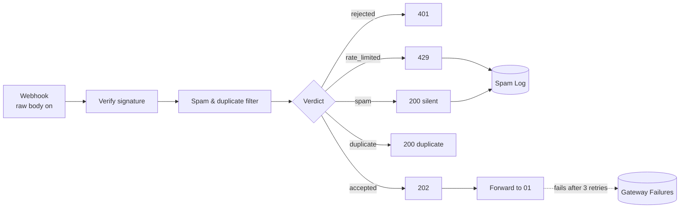

# 02 · Secure Webhook Gateway: signature, spam, rate limit, duplicates

> A small gateway in front of the lead pipeline. Only signed, human, first-time submissions reach the CRM; everything else gets the right HTTP answer and is logged.

**Status:** workflow built and importable; signature checks and filters covered by 6 unit tests (real HMAC computed in the tests). Not yet run against a live form provider.

---

## The business problem

A webhook URL is public by nature: it sits in the page source or in the form provider's settings. Within weeks of launch a typical lead form receives:

- **bot submissions** (SEO offers, crypto, random text) that become fake CRM contacts,
- **duplicates**: the visitor double-clicks, the browser resubmits on "back", or the form provider retries because the first call timed out,
- **floods** from one IP that burn through API quotas (HubSpot, OpenAI),
- **forged requests**: anyone who knows the URL can post data that looks like a real lead.

Each fake or duplicate contact costs a sales rep a minute to recognise and delete, pollutes reports, and can trigger automated nurture emails to junk addresses.

## What this workflow does

Every request goes through four checks, in this order. The order matters: the cheap, decisive checks run first.

| # | Check | Rule | Response |
|---|---|---|---|
| 1 | **Signature** | HMAC-SHA256 of the raw body with a shared secret, compared in constant time. Generic format includes a timestamp; requests older than 5 min are refused (replay protection). Typeform's `typeform-signature` format is supported too. | `401` |
| 2 | **Rate limit** | More than 5 requests from one IP in 10 minutes | `429` |
| 3 | **Spam** | A filled **honeypot** field is decisive. Otherwise two weak signals are needed: form filled in < 3 s, disposable email domain, more than 3 links, spam phrases, Cyrillic-only text in an English form | `200` (silent) |
| 4 | **Duplicate** | Same `submission_id`/`event_id` ever (24 h memory), or same email + message within 10 minutes | `200` + `duplicate: true` |
| ✔ | Accepted | Forwarded to [01 · Form → CRM](../01-form-to-crm-sheets-email) with honeypot and timing fields stripped | `202` |

Blocked requests (spam and rate-limited) are logged to the `Spam Log` tab so someone can check for false positives once a week.

### Why spam gets a normal 200

A `4xx` tells the bot author exactly which submissions are detected, and they adjust. A boring `200` gives nothing away.

### Why "two weak signals"

Any single heuristic has false positives: a real person can use a disposable address, or paste three links to their stores. Requiring two signals keeps real leads flowing; the honeypot is the only check strong enough on its own.

## Flow



## Node by node

| Node | Type | Notes |
|---|---|---|
| Secure Intake Webhook | Webhook | `POST /webhook/secure-intake`, **Raw Body** option on, response by node |
| Verify Signature | Code | [`verify-signature.js`](src/verify-signature.js) |
| Spam & Duplicate Filter | Code | [`spam-filter.js`](src/spam-filter.js), state in workflow static data |
| Route by Verdict | Switch | 5 outputs |
| Respond 401 / 429 / 200 / 200 / 202 | Respond to Webhook | No internal details in error bodies |
| Log Blocked Request | Google Sheets | Append to `Spam Log` |
| Forward to Lead Pipeline | HTTP Request | `POST {N8N_URL}/webhook/lead-form`, 3 retries, error output on |
| Log Forward Failure | Google Sheets | `Gateway Failures`: original payload kept for replay |

## Implementation details worth knowing

- **Raw body is mandatory for HMAC.** The signature is computed over the exact bytes the provider sent. Re-serialising the parsed JSON (`JSON.stringify(body)`) changes spacing and key order and the signature never matches. The Webhook node's *Raw Body* option exposes the bytes as binary data, read with `this.helpers.getBinaryDataBuffer`.
- **Constant-time comparison** (`crypto.timingSafeEqual`) avoids leaking how many characters of a guessed signature were right.
- **Fail closed.** If `WEBHOOK_SECRET` is missing, every request is rejected. A config mistake must never turn into "accept everything".
- **Static data** (`$getWorkflowStaticData('global')`) remembers fingerprints and IP counters between executions. Old entries are pruned on each run so it cannot grow forever.

## Setup

1. n8n env vars: `WEBHOOK_SECRET`, `NODE_FUNCTION_ALLOW_BUILTIN=crypto`, `N8N_BLOCK_ENV_ACCESS_IN_NODE=false` (see [`docs/SETUP.md`](../../docs/SETUP.md)).
2. **Google Sheets** credential on the two Sheets nodes; tabs `Spam Log`, `Gateway Failures`.
3. On your website form:
   - add a hidden honeypot input `website_url` (hide it with CSS, not `type="hidden"`, which bots skip),
   - add a hidden `_rendered_at` filled with `Date.now()` when the page loads,
   - sign the request server-side (or use Typeform's built-in webhook secret).
4. Deploy with `N8N_PUBLIC_URL` if the lead pipeline is not on `localhost:5678`.

## Try it

Generate a signed request (bash + openssl):

```bash
SECRET=your-secret
BODY='{"email":"ann@acme.com","message":"Please call me","_rendered_at":1}'
TS=$(date +%s)
SIG="sha256=$(printf '%s' "$TS.$BODY" | openssl dgst -sha256 -hmac "$SECRET" | sed 's/^.* //')"
curl -i -X POST http://localhost:5678/webhook/secure-intake \
  -H "Content-Type: application/json" -H "x-timestamp: $TS" -H "x-signature: $SIG" -d "$BODY"
```

Send it twice: the first answer is `202`, the second `200 {"duplicate":true}`. Change one character of the secret: `401`.

## Estimated time saved

Depends on spam volume. A form receiving 10 junk and 5 duplicate submissions a week saves ~1 minute each of recognising and deleting a contact (≈ **1 hour/month**). The bigger value is a CRM and reports that only contain real people.

## Limitations & production notes

- Static data is **only persisted for active (production) executions**, and two executions running at the same moment can both read the old state. For high traffic, move counters and fingerprints to Redis (n8n has a Redis node) with atomic `INCR`/`SET NX`.
- The IP is taken from `X-Forwarded-For`. Behind a reverse proxy that is correct; exposed directly, a client can fake it. Configure the proxy to overwrite the header.
- Heuristics need tuning per market: the Cyrillic rule is wrong for a business that sells in Eastern Europe.
- For stronger bot protection, add Cloudflare Turnstile or reCAPTCHA on the form and verify the token here.

## Files

```
workflow.mjs / workflow.json
src/verify-signature.js   HMAC (generic + Typeform), timestamp window, fail closed
src/spam-filter.js        rate limit, honeypot, weak signals, duplicate fingerprint
tests/code.test.mjs
```
