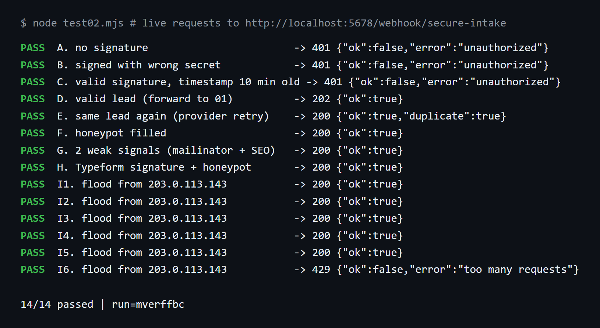
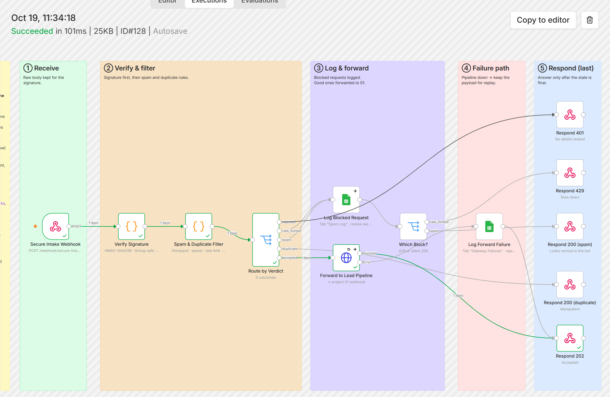
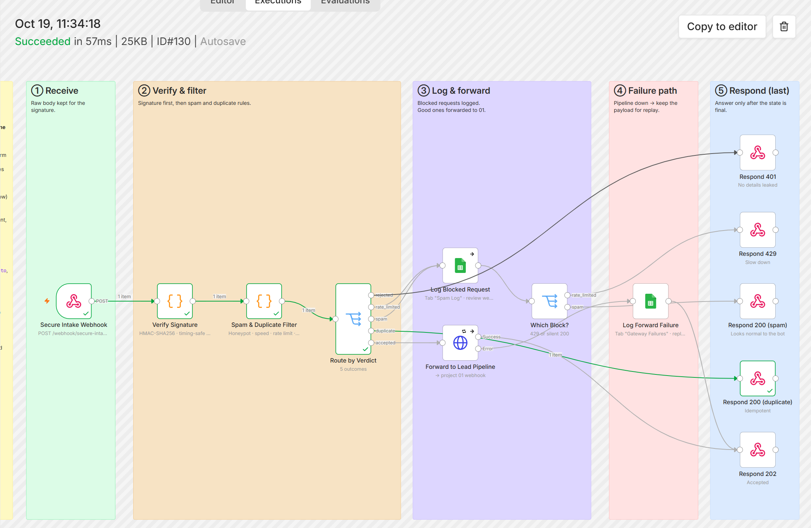
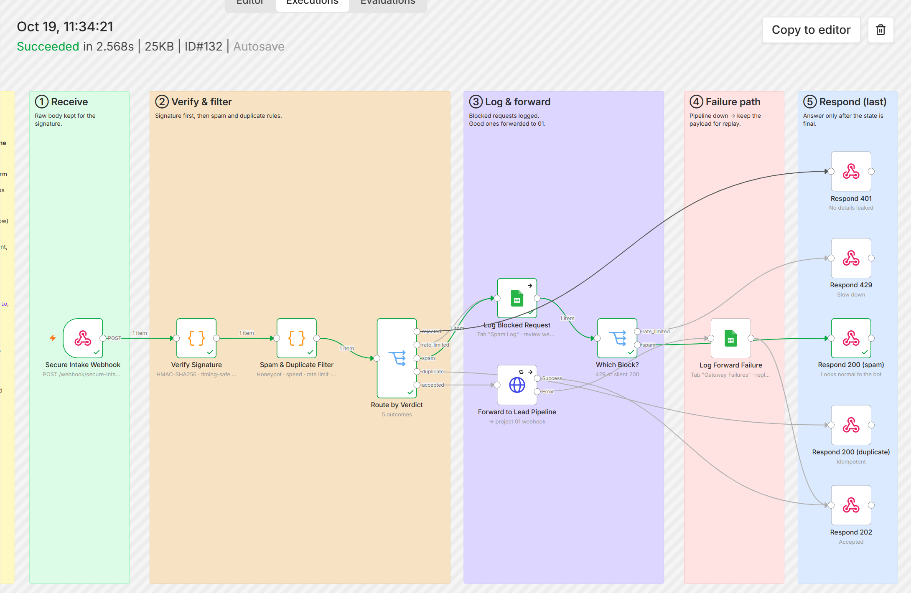
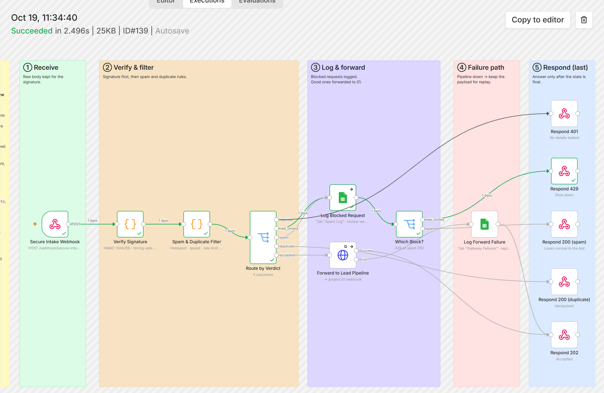
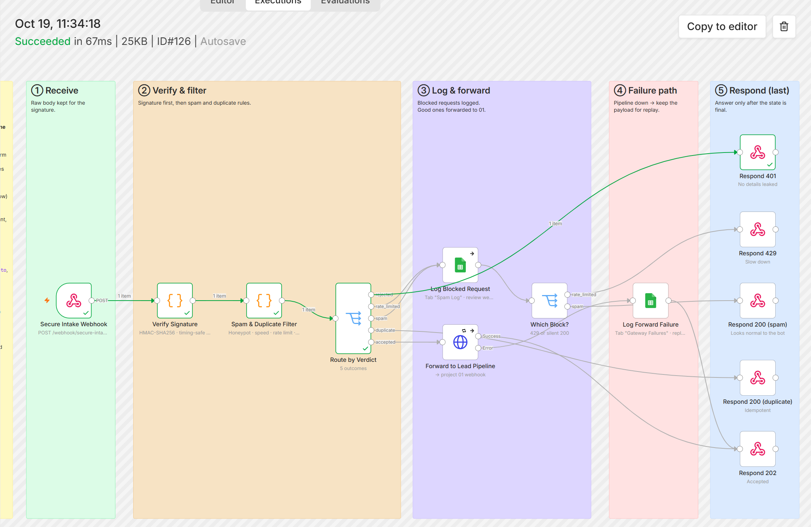
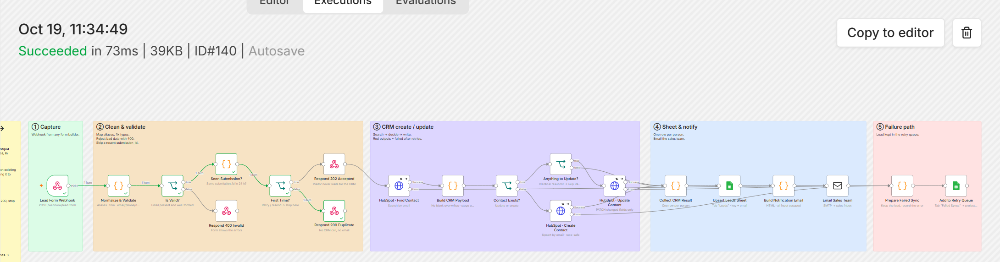
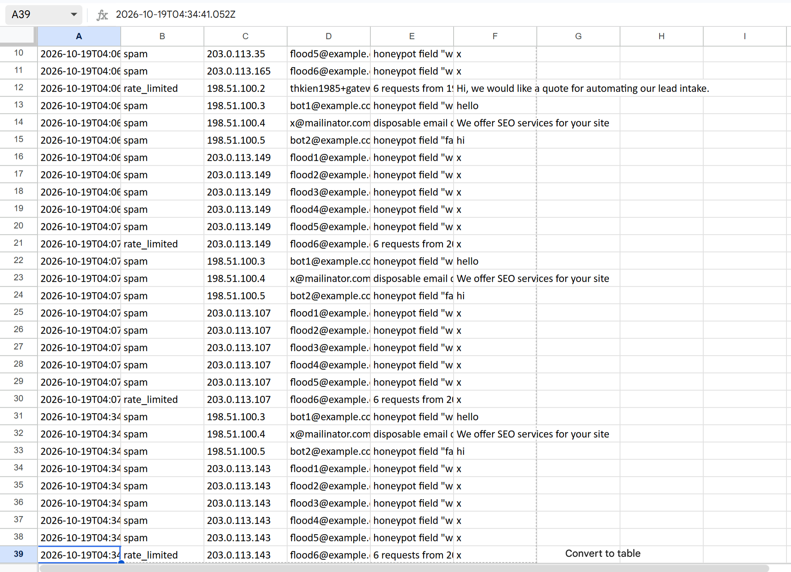
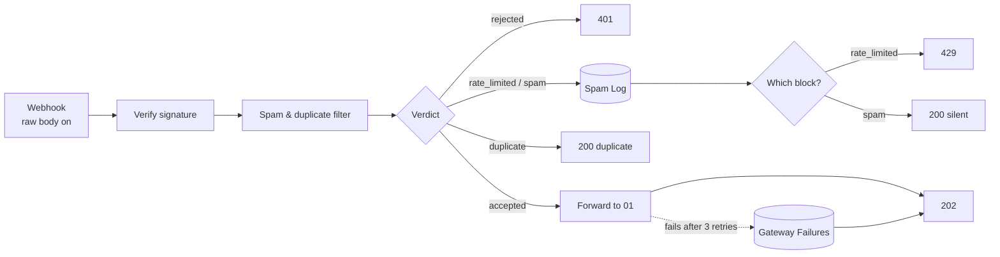

# 02 · Secure Webhook Gateway: signature, spam, rate limit, duplicates

> A small gateway in front of the lead pipeline. Only signed, human, first-time submissions reach the CRM; everything else gets the right HTTP answer and is logged.

**Status:** ran live on n8n 2.43 (2026-10-19) with 14 signed and unsigned requests, one per branch: 14/14 correct after the fix below. Signature checks and filters are also covered by 6 unit tests (real HMAC computed in the tests). Not yet connected to a real form provider (requests were sent by a test script).

**The live test run**: 14 requests, one per branch, against the running workflow



| Signed lead → forwarded to 01 → `202` | Same lead again → `200 duplicate` |
|---|---|
|  |  |
| **Disposable email + "SEO services" → logged, silent `200`** | **6th request from one IP → logged, `429`** |
|  |  |
| **Signed with the wrong secret → `401`** | **Same `submission_id` sent straight to 01 → stopped before HubSpot** |
|  |  |

**`Spam Log` tab** (blocked requests from several test runs, reviewed weekly for false positives)



---

## The business problem

A webhook URL is public by nature: it sits in the page source or in the form provider's settings. Within weeks of launch a typical lead form receives:

- **bot submissions** (SEO offers, crypto, random text) that become fake CRM contacts,
- **duplicates**: the visitor double-clicks, the browser resubmits on "back", or the form provider retries because the first call timed out,
- **floods** from one IP that burn through API quotas (HubSpot, OpenAI),
- **forged requests**: anyone who knows the URL can post data that looks like a real lead.

Each fake or duplicate contact costs a sales rep a minute to recognise and delete, pollutes reports, and can trigger automated nurture emails to junk addresses.

## What this workflow does

Every request goes through four checks, in this order. The order matters: the cheap, decisive checks run first.

| # | Check | Rule | Response |
|---|---|---|---|
| 1 | **Signature** | HMAC-SHA256 of the raw body with a shared secret, compared in constant time. Generic format includes a timestamp; requests older than 5 min are refused (replay protection). Typeform's `typeform-signature` format is supported too. | `401` |
| 2 | **Rate limit** | More than 5 requests from one IP in 10 minutes | `429` |
| 3 | **Spam** | A filled **honeypot** field is decisive. Otherwise two weak signals are needed: form filled in < 3 s, disposable email domain, more than 3 links, spam phrases, Cyrillic-only text in an English form | `200` (silent) |
| 4 | **Duplicate** | Same `submission_id`/`event_id` ever (24 h memory), or same email + message within 10 minutes | `200` + `duplicate: true` |
| ✔ | Accepted | Forwarded to [01 · Form → CRM](../01-form-to-crm-sheets-email) with honeypot and timing fields stripped | `202` |

Blocked requests (spam and rate-limited) are logged to the `Spam Log` tab so someone can check for false positives once a week.

### Why spam gets a normal 200

A `4xx` tells the bot author exactly which submissions are detected, and they adjust. A boring `200` gives nothing away.

### Why "two weak signals"

Any single heuristic has false positives: a real person can use a disposable address, or paste three links to their stores. Requiring two signals keeps real leads flowing; the honeypot is the only check strong enough on its own.

## Flow



Every response node is the **last** node of its branch (see "What the live run caught").

## Node by node

| Node | Type | Notes |
|---|---|---|
| Secure Intake Webhook | Webhook | `POST /webhook/secure-intake`, **Raw Body** option on, response by node |
| Verify Signature | Code | [`verify-signature.js`](src/verify-signature.js) |
| Spam & Duplicate Filter | Code | [`spam-filter.js`](src/spam-filter.js), state in workflow static data |
| Route by Verdict | Switch | 5 outputs |
| Log Blocked Request | Google Sheets | Append to `Spam Log`; on error continues, so the caller still gets an answer |
| Which Block? | Switch | After logging: `rate_limited` → 429, `spam` → 200 |
| Respond 401 / 429 / 200 / 200 / 202 | Respond to Webhook | Last node of each branch. No internal details in error bodies |
| Forward to Lead Pipeline | HTTP Request | `POST {N8N_URL}/webhook/lead-form`, 3 retries, error output on |
| Log Forward Failure | Google Sheets | `Gateway Failures`: original payload kept for replay |

## What the live run caught

The first live run passed 12 of 14 checks. Signature, replay window, honeypot, weak signals and the Typeform format all worked, which also confirmed the raw body arrives as binary `data`. Two checks failed:

| Request | Expected | Got |
|---|---|---|
| Same lead sent again right after the first | `200 duplicate` | `202`, forwarded again |
| 6th request from one IP | `429` | `200` |

**Cause.** n8n saves workflow static data only when an execution **finishes**. The first version answered the caller first and then forwarded to 01 / wrote the Sheet (≈ 3.5 s). The next request started before the previous execution had saved its fingerprint or IP counter, so it read stale state. After 6 flood requests the stored counter for that IP was `1`: each execution overwrote the others. Resending the same lead once the earlier executions had finished returned `duplicate: true`, so the logic was right and only the timing was wrong. Unit tests could not catch this: it needs two overlapping executions on a real n8n.

**Impact.** HubSpot still had one contact (01 upserts by email), but sales got **two emails** for one lead ("New lead" and "Returning lead").

**Fix.**
1. Every Respond node is now the last node of its branch, so the caller only gets an answer once the work is done and the execution is about to save its state. Forwarding stays fast because 01 answers `202` right away.
2. Second line of defence in [01](../01-form-to-crm-sheets-email): a `submission_id` already processed in the last 24 h returns `200 duplicate` with no CRM call and no email.

**After the fix:** 14/14, and one gateway run produces exactly one 01 execution and one email. Sending the same `submission_id` straight to 01 returns `{"duplicate":true}`.

Two requests arriving at the *same* moment can still both pass, because static data has no atomic "check and set". That is the Redis item under Limitations.

## Implementation details worth knowing

- **Raw body is mandatory for HMAC.** The signature is computed over the exact bytes the provider sent. Re-serialising the parsed JSON (`JSON.stringify(body)`) changes spacing and key order and the signature never matches. The Webhook node's *Raw Body* option exposes the bytes as binary data, read with `this.helpers.getBinaryDataBuffer`.
- **Constant-time comparison** (`crypto.timingSafeEqual`) avoids leaking how many characters of a guessed signature were right.
- **Fail closed.** If `WEBHOOK_SECRET` is missing, every request is rejected. A config mistake must never turn into "accept everything".
- **Static data** (`$getWorkflowStaticData('global')`) remembers fingerprints and IP counters between executions. Old entries are pruned on each run so it cannot grow forever.

## Setup

1. n8n env vars: `WEBHOOK_SECRET`, `NODE_FUNCTION_ALLOW_BUILTIN=crypto`, `N8N_BLOCK_ENV_ACCESS_IN_NODE=false` (see [`docs/SETUP.md`](../../docs/SETUP.md)).
2. **Google Sheets** credential on the two Sheets nodes; tabs `Spam Log`, `Gateway Failures`.
3. On your website form:
   - add a hidden honeypot input `website_url` (hide it with CSS, not `type="hidden"`, which bots skip),
   - add a hidden `_rendered_at` filled with `Date.now()` when the page loads,
   - sign the request server-side (or use Typeform's built-in webhook secret).
4. Deploy with `N8N_PUBLIC_URL` if the lead pipeline is not on `localhost:5678`.

## Try it

Generate a signed request (bash + openssl):

```bash
SECRET=your-secret
BODY='{"email":"ann@acme.com","message":"Please call me","_rendered_at":1}'
TS=$(date +%s)
SIG="sha256=$(printf '%s' "$TS.$BODY" | openssl dgst -sha256 -hmac "$SECRET" | sed 's/^.* //')"
curl -i -X POST http://localhost:5678/webhook/secure-intake \
  -H "Content-Type: application/json" -H "x-timestamp: $TS" -H "x-signature: $SIG" -d "$BODY"
```

Send it twice: the first answer is `202`, the second `200 {"duplicate":true}`. Change one character of the secret: `401`.

## Estimated time saved

Depends on spam volume. A form receiving 10 junk and 5 duplicate submissions a week saves ~1 minute each of recognising and deleting a contact (≈ **1 hour/month**). The bigger value is a CRM and reports that only contain real people.

## Limitations & production notes

- Static data is **only persisted for active (production) executions**, and it is saved when the execution ends: two executions running at the same moment can both read the old state (seen in the live run, see above). For high traffic, move counters and fingerprints to Redis (n8n has a Redis node) with atomic `INCR`/`SET NX`, e.g. a hosted Upstash database.
- The IP is taken from `X-Forwarded-For`. Behind a reverse proxy that is correct; exposed directly, a client can fake it. Configure the proxy to overwrite the header.
- Heuristics need tuning per market: the Cyrillic rule is wrong for a business that sells in Eastern Europe.
- For stronger bot protection, add Cloudflare Turnstile or reCAPTCHA on the form and verify the token here.

## Files

```
workflow.mjs / workflow.json
src/verify-signature.js   HMAC (generic + Typeform), timestamp window, fail closed
src/spam-filter.js        rate limit, honeypot, weak signals, duplicate fingerprint
tests/code.test.mjs
```
