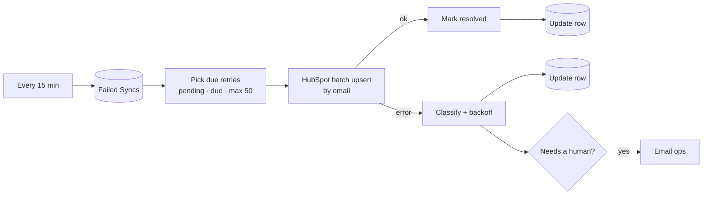

# 03 · CRM Retry Queue: failed syncs → backoff → HubSpot → escalate

> When HubSpot is down, rate-limits you, or the token expires, leads wait in a visible queue and are delivered automatically later, instead of disappearing into failed executions.

**Status:** workflow built and importable; queue selection and retry classification covered by 6 unit tests. Not yet run against a live HubSpot account.

---

## The business problem

Every integration fails sometimes:

- HubSpot has an incident or returns `502` for ten minutes,
- a bulk job elsewhere uses up the API rate limit (`429`),
- someone rotates the private app token and forgets n8n (`401`),
- a field value is rejected (`400`, e.g. an invalid dropdown option).

With a basic workflow, each of these leaves a red execution in n8n. Nobody opens executions daily, so the gap is found days later when sales asks "why isn't this lead in HubSpot?". Then someone replays executions one by one, unsure which ones already succeeded.

## What this workflow does

It is the second half of a **dead-letter queue** pattern:

1. [Project 01](../01-form-to-crm-sheets-email) catches any HubSpot failure (after its own 3 quick retries) and writes the lead to the **`Failed Syncs`** tab with `status = pending` and the HubSpot properties as JSON.
2. This worker runs **every 15 minutes**, picks rows that are due, and upserts them to HubSpot by email.
3. Each result is written back to the same row:

| Result | Classification | New status | Next attempt |
|---|---|---|---|
| 2xx | – | `resolved` + HubSpot contact ID | – |
| 400, 404, 409, 422 | **permanent**: the data is wrong | `dead` immediately + email ops | never (until a human fixes it) |
| 401, 403 | **auth**: token or scope problem | `pending` + email ops **on the first failure only** | backoff |
| 429, 5xx, timeout, network | **temporary** | `pending` | 15 min → 30 min → 1 h → 2 h → 4 h (cap 6 h), + up to 60 s jitter |
| 6th failed attempt | – | `dead` + email ops | never |

### Why classify errors

Retrying a `400` forever wastes API calls and hides a real data problem. Not retrying a `503` loses a lead that would have worked ten minutes later. And an expired token needs a human **now**, not after six attempts.

### Why the sheet is the queue

For a small team a Google Sheet is the most transparent queue there is: anyone can see what is stuck, edit a broken value, and set `status` back to `pending` to retry. No extra infrastructure. (See limitations for when to move to a database.)

## Flow



## Node by node

| Node | Type | Notes |
|---|---|---|
| Every 15 Minutes | Schedule | `*/15 * * * *` |
| Read Retry Queue | Google Sheets | Always outputs data, so an empty tab ends quietly |
| Pick Due Retries | Code | [`pick-due.js`](src/pick-due.js): `pending`, `next_retry_at <= now`, oldest first, **max 50 per run** |
| HubSpot · Upsert Contact | HTTP Request | `POST /crm/v3/objects/contacts/batch/upsert`. Node-level retry **off**: the queue is the retry mechanism |
| Mark Resolved | Code (per item) | [`mark-resolved.js`](src/mark-resolved.js) |
| Update Row (resolved) | Google Sheets | `update`, match `queue_id` |
| Schedule Next Retry | Code (per item) | [`next-retry.js`](src/next-retry.js): classification, backoff, jitter, email text |
| Update Row (failed) | Google Sheets | `update`, match `queue_id` |
| Needs a Human? → Email Ops | IF → SMTP | Only `dead` rows and the first auth failure |

## Design decisions

- **Max 50 per run.** After a 2-hour outage there may be hundreds of rows. Sending them all at once would hit HubSpot's rate limit and fail again. 50 every 15 minutes drains 200/hour while leaving capacity for live traffic.
- **Jitter.** Without it, every lead that failed during the same minute retries during the same minute, again and again.
- **Upsert by email** makes retries idempotent: if an earlier attempt actually succeeded but the response was lost (timeout), the retry updates the same contact instead of creating a duplicate.
- **Per-item Code mode with `$('Pick Due Retries').item`** keeps each HubSpot response paired with its own queue row, even though the success and error branches split the items.

## Setup

1. Credentials: **Google Sheets** (3 nodes), **HubSpot Service Key**, **SMTP**.
2. Tab `Failed Syncs` with the columns in [`docs/SETUP.md`](../../docs/SETUP.md). Project 01 writes to it.
3. Set `OPS_EMAIL` when deploying.

## Try it

Add a row to `Failed Syncs` by hand:

| queue_id | created_at | email | payload | attempts | status | next_retry_at |
|---|---|---|---|---|---|---|
| Q-TEST-1 | 2026-10-17T09:00:00Z | test.retry@example.org | `{"email":"test.retry@example.org","firstname":"Retry"}` | 0 | pending | |

Execute the workflow: the row becomes `resolved` with a HubSpot ID. Change the payload to `{"email":"bad","lifecyclestage":"nonsense"}` and set it back to `pending`: HubSpot answers 400, the row becomes `dead` and ops gets an email.

## Estimated time saved

Hard to put a number on: it depends on how often integrations break. The real benefit is **zero lost leads** and no manual replay. One outage handled by hand (find failed executions, check which already synced, replay) typically takes 30–60 minutes.

## Limitations & production notes

- Two overlapping runs could pick the same row. With a 15-minute interval and ≤ 50 rows that is very unlikely; for heavy use, mark rows `processing` first or move the queue to Postgres with `SELECT … FOR UPDATE SKIP LOCKED`.
- The payload created by 01 for a new contact contains `lifecyclestage: lead`. If the person became a customer in the meantime, HubSpot may refuse to move the stage backwards. Fix: strip `lifecyclestage` from the payload when `attempts > 0`.
- Google Sheets has API quotas (about 60 writes per minute per user). Fine for this volume, not for thousands of rows per hour.

## Files

```
workflow.mjs / workflow.json
src/pick-due.js        select due rows, build the upsert body
src/mark-resolved.js   success branch
src/next-retry.js      error classification, exponential backoff, escalation email
tests/code.test.mjs
```
