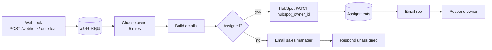

# 04 · Lead Routing: territory + segment + round robin → HubSpot owner

> Every new lead gets the right owner in HubSpot within seconds and the rep gets an email. Routing rules live in a Google Sheet the sales manager edits, not in code.

**Status:** workflow built and importable; routing rules covered by 5 unit tests with a sample sales team. Not yet run against a live HubSpot account.

---

## The business problem

In a sales team of 3–10 reps, assignment usually works like this: leads land in a shared inbox or an "Unassigned" HubSpot view, and a manager hands them out when they have a minute. Problems:

- **Delay.** Leads wait until the manager is free; contacting a lead within the first hour converts far better than the next day.
- **Unfairness.** Whoever sits closest to the manager gets the good ones.
- **Holidays.** A lead is given to a rep who is on vacation and nobody notices for a week.
- **Stolen accounts.** An existing customer fills the form again and is given to a new rep, who calls them as a "new lead".

## What this workflow does

Rules, in the order they are applied ([`src/choose-owner.js`](src/choose-owner.js)):

| # | Rule | Example |
|---|---|---|
| 1 | Contact **already has an owner** in HubSpot → keep it | Existing customer resubmits → still goes to their account manager |
| 2 | **Segment** by company size: 500+ employees = `enterprise`, else `smb` | 2,500 employees → only reps with `enterprise` in `segments` |
| 3 | **Territory**: reps covering the lead's country are preferred over reps marked `*` (everywhere) | US lead → Alice/Ben (US,CA) before Eva (*) |
| 4 | Skip **inactive** reps and reps whose `out_of_office_until` is today or later | Chloe on holiday → UK lead goes to the global pool |
| 5 | **Round robin** inside the remaining pool | Alice, Ben, Alice, Ben… |

If no rep matches, the lead is **not dropped**: the sales manager gets an "Unassigned lead" email.

The decision, the rule that was applied and the owner are logged to an `Assignments` tab, so "why did Ben get this lead?" always has an answer.

### The rules are data

The manager controls routing from the `Sales Reps` tab:

| name | email | hubspot_owner_id | active | territories | segments | out_of_office_until |
|---|---|---|---|---|---|---|
| Alice Nguyen | alice@… | 51001 | TRUE | US,CA | smb | |
| Chloe Martin | chloe@… | 51003 | TRUE | GB,DE,FR | smb | 2026-10-24 |
| Daniel Kim | daniel@… | 51004 | TRUE | * | enterprise | |

Adding a rep, a holiday, or a new territory is a sheet edit. No workflow change, no developer.

## Flow



## Node by node

| Node | Type | Notes |
|---|---|---|
| Route Lead Webhook | Webhook | Body: `hubspot_contact_id, email, name, company, country, employees, current_owner_id` |
| Read Sales Reps | Google Sheets | One item per rep |
| Choose Owner | Code | [`choose-owner.js`](src/choose-owner.js): rules + round-robin pointer in static data |
| Build Emails | Code | [`build-emails.js`](src/build-emails.js) |
| Owner Assigned? | IF | |
| Owner Changed? | IF | Existing owner kept → skip the HubSpot call; the rep gets a "your contact got back in touch" email instead of "new lead" |
| HubSpot · Set Contact Owner | HTTP Request | `PATCH /crm/v3/objects/contacts/{id}` with `hubspot_owner_id` |
| Log Assignment | Google Sheets | Append to `Assignments` |
| Email Assigned Rep / Email Sales Manager | SMTP | |
| Respond Owner / Respond Unassigned | Respond to Webhook | The caller learns who owns the lead |

## Implementation details

- **Country normalisation.** "United States", "USA", "us", "U.S." all become `US`. Unknown values fall back to the first two letters upper-cased, which is wrong sometimes, so extend the `COUNTRY` map for your markets.
- **Employees** accepts `"2,500"`, `"500+"`, `"1000"`.
- **Round-robin pointer per pool.** The key includes the pool members, so adding or removing a rep restarts that pool's rotation instead of skipping someone.
- **Stable ordering.** The pool is sorted by email before rotating; otherwise reordering rows in the sheet would change who is next.

## Setup

1. Credentials: **Google Sheets**, **HubSpot Service Key** (`crm.objects.contacts.write`), **SMTP**.
2. Create the `Sales Reps` tab from [`samples/Sales Reps.csv`](samples/Sales%20Reps.csv) and fill in real owner IDs (HubSpot → Settings → Users & Teams, or `GET /crm/v3/owners`). Create `Assignments`.
3. Call it from project 01: add an HTTP Request after *Collect CRM Result* → `POST /webhook/route-lead`. Or call it from HubSpot (workflow webhook action), Zapier, anything that can POST.

## Try it

```bash
curl -X POST http://localhost:5678/webhook-test/route-lead -H "Content-Type: application/json" \
  -d '{"hubspot_contact_id":"12345","email":"cto@bigco.com","name":"Lena Fischer","company":"BigCo","country":"Germany","employees":"2,500"}'
```

Expected: `{"ok":true,"owner":{"name":"Daniel Kim",…},"rule":"enterprise · global pool · round robin 1/2"}`.

## Estimated time saved

~2–3 min of manager time per lead (read, decide, assign, notify). At 150 leads/month ≈ **6 hours/month**. The larger effect is speed: the rep knows within seconds instead of whenever the manager checks the inbox. *Estimate; measure before and after.*

## Limitations & production notes

- Round-robin state lives in workflow static data: it is saved only for **active** executions, and two leads routed in the same second may get the same rep. For strict fairness, store the pointer in the sheet or Redis.
- No capacity rule yet (e.g. max 20 open leads per rep). It needs open-lead counts per owner from HubSpot (`/crm/v3/objects/contacts/search` grouped by owner) before choosing.
- HubSpot has its own "rotate record to owner" action in paid Workflows (Professional+). This build is for teams on the free/Starter tiers or with rules HubSpot cannot express.

## Files

```
workflow.mjs / workflow.json
src/choose-owner.js    routing rules + round robin
src/build-emails.js    rep / manager email
samples/Sales Reps.csv example team
tests/code.test.mjs
```
