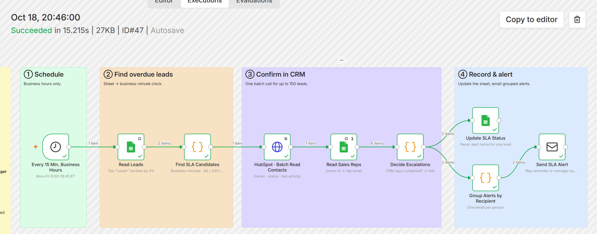
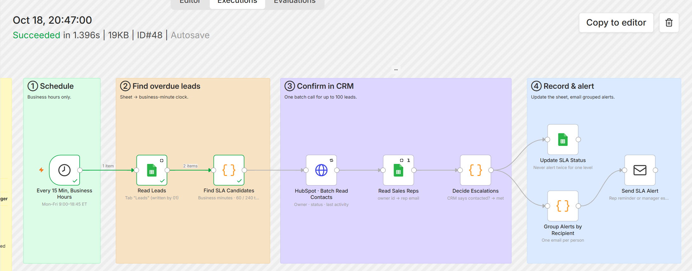
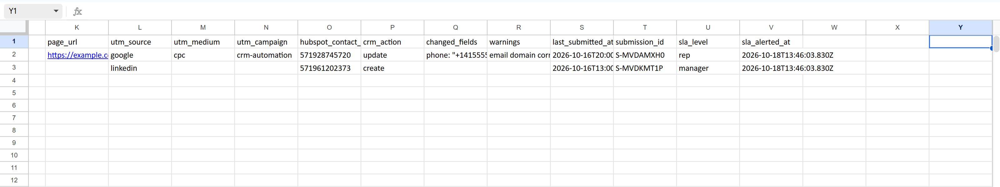
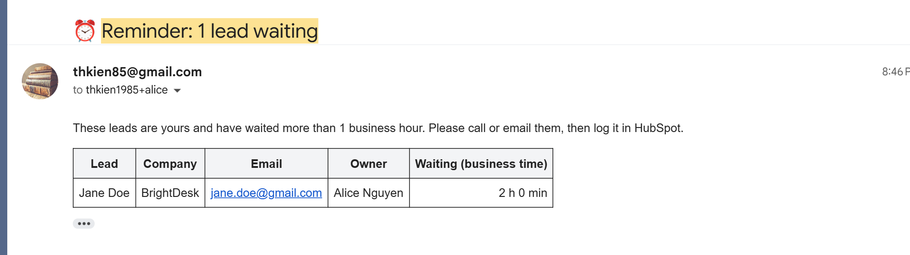
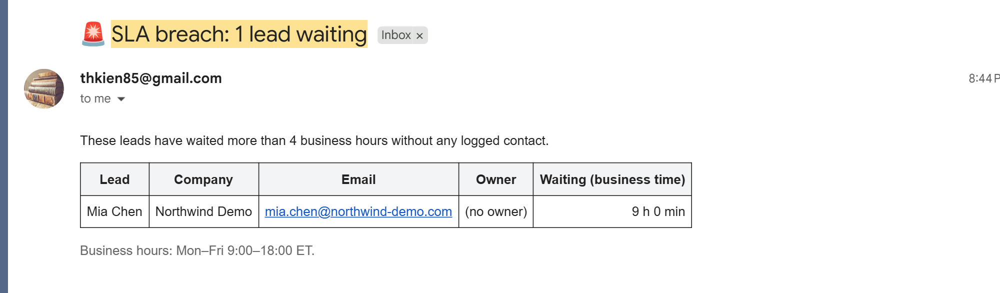
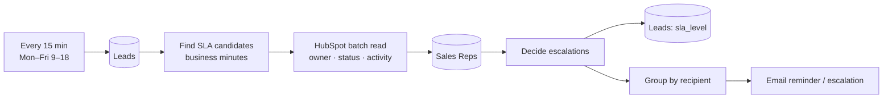

# 05 · Speed-to-Lead SLA: business-hours clock → HubSpot check → reminders & escalation

> No lead waits more than one business hour without someone being reminded, and four business hours without the sales manager knowing. Leads already contacted are never nagged about.

**Status:** **run live on 2026-10-18** against a HubSpot free account, Google Sheets and Gmail, using the leads created by project 01 and the rep list of project 04. The test ran on a Sunday, so the two leads' `last_submitted_at` were moved back to Friday 16 October (ET) and the schedule was switched to every minute for single runs, then restored. Results: a lead waiting **120 business minutes** with an owner → reminder to the owner; a lead waiting **540 business minutes** with no owner → escalation to the manager; a second run sent **nothing** and made no HubSpot call. The "already contacted → `met`" branch has not been run live yet. Logic is also covered by 6 unit tests with a frozen clock.

| Alerts sent (HubSpot checked, two recipients) | Next run: already alerted → stops early, no repeat |
|---|---|
|  |  |

**`Leads` tab after the run**: `sla_level` remembers what was already sent



| Reminder to the owner (1 business hour) | Escalation to the manager (4 business hours / no owner) |
|---|---|
|  |  |

### What the live run caught

The first live run sent the owner reminder to **a rep marked `active = FALSE`** in the `Sales Reps` tab. The owner-id → rep lookup ignored the `active` column, and with several rows sharing one owner id the last row won. In a real team this is the rep who left the company but still owns contacts in HubSpot: the reminder lands in a mailbox nobody reads. Now an active row wins when ids repeat, and a contact owned only by an inactive rep is escalated to the manager with the owner shown as `Name (inactive)`. A unit test reproduces the live case.

---

## The business problem

Most teams agree on a response target ("we reply to every inbound lead within an hour"), but nobody measures it. The usual failure: a demo request comes in on Tuesday, the owner is busy, and the manager discovers it on Friday during pipeline review.

Simple "older than 1 hour" checks create a different problem: a lead sent Friday 17:30 triggers an escalation at 18:30 and all weekend, and reps learn to ignore the alerts.

## What this workflow does

Every 15 minutes during business hours:

1. Reads the `Leads` tab written by [project 01](../01-form-to-crm-sheets-email).
2. For each recent lead, computes **business minutes** since submission: Mon–Fri 9:00–18:00 America/New_York, holidays excluded.
3. Leads past a threshold are checked **in HubSpot** (one batch call for up to 100 contacts):
   - logged sales activity after the submission (`hs_last_sales_activity_timestamp`, `notes_last_contacted`), or
   - lead status moved past `NEW`/`OPEN`,

   → the SLA is **met**, the row is marked and nobody is emailed.
4. Otherwise:

| Business time waiting | Who is told |
|---|---|
| ≥ 60 min | The **owner** (reminder) |
| ≥ 240 min | The **sales manager** (escalation) |
| Lead has no owner, or owner unknown | The **manager** straight away |

5. Alerts are **grouped per recipient**: a rep with three overdue leads gets one email with a table, not three emails.
6. `sla_level` is written back to the sheet so each level is sent **once**. When the person submits the form again, project 01 resets it and the clock restarts.

## Business-hours examples

| Submitted (ET) | Checked at (ET) | Business minutes |
|---|---|---|
| Fri 17:30 | Mon 10:00 | **90** (30 Fri + 60 Mon) |
| Sun 11:00 | Mon 10:00 | **60** |
| Mon 09:30 | Mon 10:00 | **30**, not due yet |

These three cases are unit tests ([`tests/code.test.mjs`](tests/code.test.mjs)).

## Flow



## Node by node

| Node | Type | Notes |
|---|---|---|
| Every 15 Min, Business Hours | Schedule | `*/15 9-18 * * 1-5`, workflow timezone America/New_York |
| Read Leads | Google Sheets | |
| Find SLA Candidates | Code | [`find-candidates.js`](src/find-candidates.js): business-minute clock, thresholds, 5-day lookback |
| HubSpot · Batch Read Contacts | HTTP Request | `POST /crm/v3/objects/contacts/batch/read` |
| Read Sales Reps | Google Sheets | Execute once; maps `hubspot_owner_id` → rep email |
| Decide Escalations | Code | [`decide-escalations.js`](src/decide-escalations.js) |
| Update SLA Status | Google Sheets | `update` by `email`: `sla_level`, `sla_alerted_at` |
| Group Alerts by Recipient | Code | [`group-alerts.js`](src/group-alerts.js) |
| Send SLA Alert | SMTP | |

## Design decisions

- **The CRM is the source of truth.** The sheet knows when a lead arrived; only HubSpot knows whether someone called. Checking HubSpot before alerting is what keeps alerts trustworthy.
- **Business minutes are computed with real instants** stepped in 5-minute increments and converted with `Intl.DateTimeFormat` to the office timezone, so daylight-saving changes are handled without a date library.
- **No candidates → the workflow stops after one Code node.** Most runs cost no HubSpot call.

## Setup

1. Credentials: **Google Sheets** (3 nodes), **HubSpot Service Key** (`crm.objects.contacts.read`), **SMTP**.
2. Tabs `Leads` (from 01) and `Sales Reps` (from 04).
3. Adjust in `find-candidates.js`: `TZ`, `OPEN_MIN`/`CLOSE_MIN`, `HOLIDAYS`, `LEVELS`. Manager address = `SALES_EMAIL` at deploy time.

## Try it

1. In `Leads`, set one row's `last_submitted_at` to two business hours ago, `sla_level` empty, `hubspot_contact_id` to a real contact with lead status `NEW`.
2. Execute the workflow. The owner (or the manager) receives a reminder; the row's `sla_level` becomes `rep`.
3. Execute again: no second email.
4. Log a call on the contact in HubSpot, clear `sla_level`, execute: the row becomes `met`, no email.

## Estimated time saved

Replaces a manager checking "who hasn't been called yet" (~15 min/day ≈ **5 hours/month**). The real value is commercial: fewer leads going cold. *Estimate.*

## Limitations & production notes

- One office timezone. For teams across timezones, add a `timezone` column to `Sales Reps` and compute business time per owner.
- HubSpot's `hs_last_sales_activity_timestamp` is updated by logged calls, emails and meetings. Activity done outside HubSpot (WhatsApp, personal phone) is invisible, so reps must log it.
- Holiday list is static; update it yearly or read it from a sheet tab.

## Files

```
workflow.mjs / workflow.json
src/find-candidates.js      business-minute clock + thresholds
src/decide-escalations.js   HubSpot check, owner lookup, level decision
src/group-alerts.js         one email per recipient
tests/code.test.mjs
```
