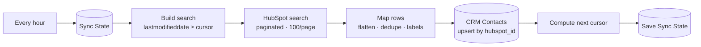

# 06 · Incremental Sync: HubSpot contacts → Google Sheets (cursor + pagination)

> A Google Sheet that mirrors HubSpot contacts and refreshes every hour, fetching only what changed since the last run.

**Status:** workflow built and importable; cursor, page flattening and dedupe covered by 3 unit tests. HubSpot pagination settings not yet run against a live account.

---

## The business problem

Managers, finance and founders want CRM data in a spreadsheet: pivot tables, Looker Studio dashboards, commission calculations, sharing with people who have no HubSpot seat. The usual solution is a manual CSV export every Monday, so the sheet is wrong six days a week, and someone spends 20–30 minutes on every export cleaning up the columns.

A naive automation that downloads **all** contacts every hour is slow, burns API quota, and breaks once the CRM grows past a few thousand records.

## What this workflow does

An **incremental** sync with a **cursor**:

1. Read the cursor from the `Sync State` tab: the newest `lastmodifieddate` synced so far (first run: last 30 days).
2. HubSpot **search** for contacts with `lastmodifieddate >= cursor`, **sorted oldest first**, 100 per page, following `paging.next.after` for up to 50 pages, 250 ms apart.
3. Flatten all pages, **dedupe** by ID (keep the newest copy), translate internal values to the labels people see in HubSpot (`salesqualifiedlead` → `SQL`, `IN_PROGRESS` → `In progress`), compute `days_since_sales_activity`.
4. **Upsert** into the `CRM Contacts` tab by `hubspot_id`.
5. **Only after the write succeeded**, save the new cursor = newest `lastmodifieddate` actually received.

## The edge cases that make or break a sync

| Problem | Handling |
|---|---|
| A contact is edited while we are paging → it moves and shows up on two pages | Dedupe by ID, keep the copy with the newest `lastmodifieddate` |
| Two contacts modified in the same millisecond as the cursor | Filter is `GTE`, not `GT`. The boundary row is re-read and the upsert makes that harmless |
| Sheet write fails halfway | Cursor is not moved, so the next run fetches the same contacts again. Nothing skipped |
| HubSpot's search index lags a few seconds behind writes | Cursor = newest timestamp **received**, never "now". A contact changed just before the run is caught next time |
| Search returns at most 10,000 results per query | Sorted ascending + cursor from received data → a big backlog is drained over several runs (`sync_note` column says so) |
| First run, or someone wants a full refresh | Clear `value` in `Sync State` → last 30 days are re-synced |

## Flow



## Node by node

| Node | Type | Notes |
|---|---|---|
| Every Hour | Schedule | Minute 5 of every hour |
| Read Sync State | Google Sheets | `key` / `value` rows |
| Build Search Request | Code | [`build-search.js`](src/build-search.js) |
| HubSpot · Search Changed Contacts | HTTP Request | `POST /crm/v3/objects/contacts/search`. **Pagination**: update body param `after` from `$response.body.paging.next.after`, stop when absent, max 50 requests, 250 ms interval |
| Map Rows | Code | [`map-rows.js`](src/map-rows.js) |
| Upsert CRM Contacts Sheet | Google Sheets | `appendOrUpdate`, match `hubspot_id` |
| Compute Next Cursor | Code | [`next-cursor.js`](src/next-cursor.js) |
| Save Sync State | Google Sheets | `appendOrUpdate`, match `key` |

## Why one-way

Two-way sync sounds better but needs conflict rules: if a rep edits HubSpot and a manager edits the sheet in the same hour, who wins? Without a clear owner per field, two-way sync silently destroys data. Here HubSpot stays the **single source of truth** and the sheet is **read-only reporting**. If a sheet-to-CRM direction is needed, it should be limited to specific columns (e.g. a `manager_note`) written to specific HubSpot properties.

## Setup

1. Credentials: **HubSpot App Token** (`crm.objects.contacts.read`), **Google Sheets** (3 nodes).
2. Tabs `Sync State` (header row only) and `CRM Contacts` with the columns in [`docs/SETUP.md`](../../docs/SETUP.md).
3. To sync more properties: add them to `properties` in `build-search.js`, map them in `map-rows.js`, add the column to `ROW_FIELDS` in `workflow.mjs` and to the sheet.

## Try it

Execute the workflow once: the last 30 days of changed contacts appear in `CRM Contacts`, and `Sync State` has one row `contacts_last_modified | <timestamp> | <rows>`. Edit a contact in HubSpot, wait ~10 seconds, execute again: only that contact is fetched and its row is updated in place.

## Estimated time saved

Replaces a weekly manual export and cleanup (~30 min/week ≈ **2 hours/month**), and the sheet is never more than an hour old. *Estimate.*

## Limitations & production notes

- Deleted or merged contacts are not removed from the sheet (the search API does not return them). A weekly full reconciliation or HubSpot webhooks (`contact.deletion`) would handle that.
- Google Sheets slows down past ~50k rows. Beyond that, sync into BigQuery or Postgres and point the dashboard there.
- The same pattern works for deals and companies: change the object path and the properties.

## Files

```
workflow.mjs / workflow.json
src/build-search.js   cursor → search body
src/map-rows.js       pages → rows, dedupe, label mapping
src/next-cursor.js    newest timestamp received
tests/code.test.mjs
```
