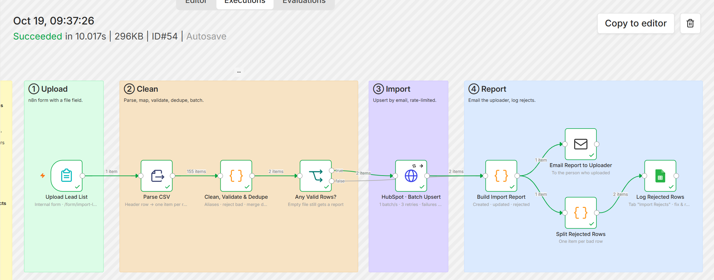
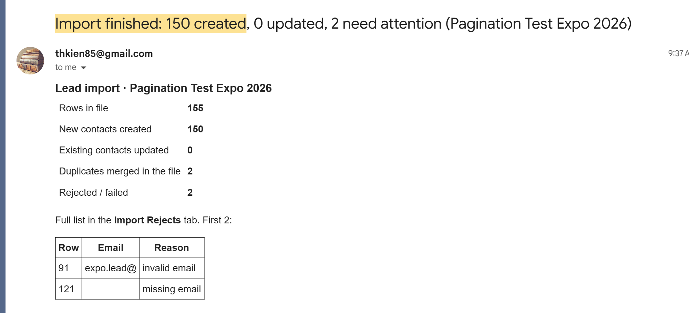
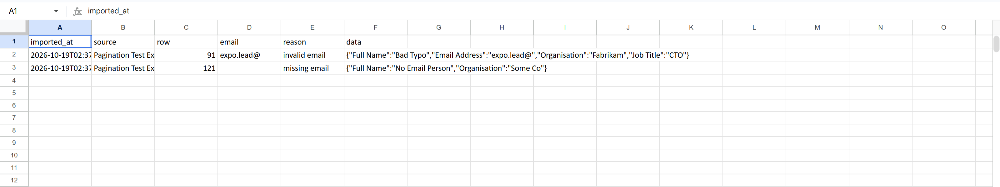
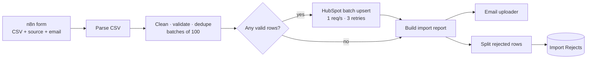

# 07 · Bulk CSV Import: clean → dedupe → HubSpot batch upsert → report

> After a trade show or webinar, upload the lead list once. The workflow maps the columns, rejects bad rows with a reason, merges duplicates, imports in batches without creating duplicate contacts, and emails a report.

**Status:** **run live on 2026-10-19** against a HubSpot free account, Google Sheets and Gmail. The uploaded file had 155 lines: 150 test contacts (`expo.leadNNN@example.com`) plus planted problems (two emails repeated, one of them in upper case; an invalid email; a row with no email; a blank line). Result: **150 contacts created** in **2 batches (100 + 50)**, both `COMPLETE`; **2 duplicates merged**, **2 rows rejected** with their row numbers; report emailed to the uploader and both rejects written to `Import Rejects`. Logic is also covered by 4 unit tests.

**Execution**: 155 rows → 2 batches → HubSpot → report email + rejected rows



| Report emailed to the uploader | `Import Rejects` tab |
|---|---|
|  |  |

### What the live run showed

Reading the uploaded file with `{{ Object.keys($binary)[0] }}` works with the binary name n8n's Form Trigger actually produces, so the file field can be renamed without breaking the parser. The 150 contacts created here were then used to test [project 06](../06-crm-to-sheets-incremental-sync)'s pagination.

---

## The business problem

Event lists are messy. A typical export from an event app, a badge scanner or a LinkedIn campaign has:

- headers that differ every time (`E-mail`, `Email Address`, `Company Name`, `Organisation`),
- blank lines, missing emails, `sam@` typos,
- the same person twice (scanned at two booths),
- people who are **already** in the CRM, some of them customers.

Doing it by hand means 1–3 hours in Excel, then HubSpot's import wizard, and still finding duplicates afterwards. HubSpot's own import can deduplicate by email, but it does not tell the person who uploaded the file which rows were dropped and why.

## What this workflow does

1. **Internal n8n form** with three fields: the CSV file, a source name ("SaaS Expo Austin 2026") and the uploader's email.
2. **Parse CSV** (Extract From File).
3. **Clean, validate & dedupe** ([`clean-rows.js`](src/clean-rows.js)):
   - headers matched through aliases, whatever their case, spacing or punctuation (a UTF-8 BOM is handled too),
   - `Full Name` split when there are no first/last columns,
   - rows **rejected** with a reason: `missing email`, `invalid email`, with their original row number,
   - the same email twice in the file → **merged** (first copy wins, blanks filled from the second),
   - blank values never sent (so they cannot overwrite CRM data),
   - batches of **100**, HubSpot's batch limit.
4. **HubSpot batch upsert** by email, **one request per second**, 3 retries.
5. **Report** ([`import-report.js`](src/import-report.js)):
   - created vs updated (HubSpot's `new` flag per record),
   - rejected rows, rows inside **failed batches**, and per-record errors from **207 Multi-Status** responses,
   - emailed to the uploader, and every problem row written to `Import Rejects`.

## Why dedupe *before* HubSpot

If one email appears twice **in the same batch**, HubSpot rejects the **entire** batch of 100. Dedupe in code is not a nice-to-have here; without it, one duplicate loses 99 good rows.

## Flow



## Node by node

| Node | Type | Notes |
|---|---|---|
| Upload Lead List | Form Trigger | `/form/import-leads`, file field accepts `.csv` |
| Parse CSV | Extract From File | Binary field chosen with `{{ Object.keys($binary)[0] }}`, so it works whatever name n8n gives the upload |
| Clean, Validate & Dedupe | Code | One item per batch; stats + rejects travel on the first item |
| Any Valid Rows? | IF | A file with zero good rows still gets a report |
| HubSpot · Batch Upsert | HTTP Request | `POST /crm/v3/objects/contacts/batch/upsert`, batching 1 item / 1000 ms, `onError: continue` so failures reach the report |
| Build Import Report | Code | Pairs each response with its batch by position |
| Email Report to Uploader | SMTP | |
| Split Rejected Rows → Log Rejected Rows | Code → Google Sheets | `Import Rejects` tab |

## Example

Input [`samples/expo-leads.csv`](samples/expo-leads.csv) (7 data lines):

| Row | Data | Result |
|---|---|---|
| 2 | Maria Lopez, Head of Sales | ✅ kept |
| 3 | Tom Becker, `TOM.BECKER@contoso.de`, no title | ✅ email lower-cased, no blank title sent |
| 4 | Maria Lopez again, VP Sales | 🔀 merged into row 2 (title kept from the first copy) |
| 5 | Sam Park, `sam.park@` | ❌ invalid email |
| 6 | blank line | skipped silently |
| 7 | Priya Shah | ✅ kept |
| 8 | No email | ❌ missing email |

Report: *3 contacts imported, 1 duplicate merged, 2 need attention.*

## Setup

1. Credentials: **HubSpot Service Key** (`crm.objects.contacts.write`), **Google Sheets**, **SMTP**.
2. Tab `Import Rejects`.
3. Share the form URL (`/form/import-leads`) with the marketing team only. For a public n8n instance, put it behind basic auth (Form Trigger → Authentication).
4. Extra columns (e.g. `industry`): add an alias in `ALIASES` and make sure the HubSpot property exists.

## Try it

Open the form's test URL, upload `samples/expo-leads.csv`, enter your email. You should receive the report email and see two rows in `Import Rejects`.

## Estimated time saved

~1.5–3 hours per event list (cleanup + import + duplicate fixing). With 2 events or webinars a month ≈ **3–6 hours/month**. *Estimate.*

## Limitations & production notes

- Large files: the Form Trigger and the Code node hold the whole file in memory. Fine for a few thousand rows; for 50k+ rows use a file in Google Drive and process it in chunks.
- Merge policy is "first copy wins". Some teams prefer "most recent wins" or "most complete row wins"; it is a one-line change.
- No consent flag is set. Imported event leads may need a lawful basis for marketing email (GDPR/CAN-SPAM); add a `consent_source` property per list.

## Files

```
workflow.mjs / workflow.json
src/clean-rows.js       aliases, validation, merge, batching
src/import-report.js    created/updated/failed + HTML email
src/rejected-rows.js    one item per problem row
samples/expo-leads.csv  messy example list
tests/code.test.mjs
```
