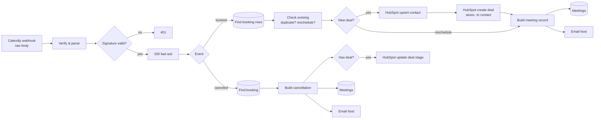

# 09 · Calendly Booking → HubSpot Contact + Deal → Meetings Sheet → Email Host

> A booked demo becomes a HubSpot deal automatically. Reschedules keep the same deal, cancellations move it and record the reason, and webhook retries never create a second deal.

**Status:** run end-to-end on 2026-10-20 against **live HubSpot, Google Sheets and SMTP**. The Calendly side was simulated: webhooks in Calendly's payload format, signed locally with the same HMAC scheme (a Calendly webhook subscription needs a paid plan). 8 unit tests.

## What the live run caught

Ten signed requests were sent: 3 with a missing, wrong or expired signature, a new booking, a retry of it, a reschedule (cancel half + create half), a retry of the reschedule and a real cancellation.

| Request | Result |
|---|---|
| No / wrong / 10-min-old signature | `401`, reason logged (`no signature header`, `bad signature`, `signature timestamp too old`) |
| New booking | Contact upserted, deal *Vela Logistics · 30-min Demo* in *Appointment scheduled*, row `Booked`, host email |
| Same booking again | Stopped at *Check Existing Booking*. One deal |
| Reschedule | Cancel half ignored. Same deal reused, rows `Rescheduled` + `Moved`, one email |
| **Reschedule again (retry)** | **Bug:** a second "Rescheduled" email was sent |
| Real cancellation | Deal → `closedlost` with *Meeting canceled: We picked another vendor*, row `Canceled`, host email |

**The bug.** For a reschedule the sheet is searched by the *old* invitee URI (that is where the deal ID is), so the new row is never in the lookup result and the duplicate check did not fire. A retried reschedule ran the whole branch again: a duplicate email, and if the retry arrived after a cancellation it would have rewritten the `Canceled` row back to `Rescheduled`. **Fix:** once a reschedule is processed the old row is `Moved`, so an old row that is already `Moved` means "seen it" and the flow stops. Re-sent after the fix: stops at *Check Existing Booking*.

The raw-body binary used for the signature check (`rawBody: true` on the Webhook node) works in n8n 2.x.

---

## The business problem

Prospects book demos through a Calendly link. After each booking the rep has to:

1. find or create the contact in HubSpot,
2. create a deal, link it to the contact, set the stage,
3. copy the answers from the booking form ("company", "what do you want to cover?"),
4. update the deal when the meeting is moved, or close it when it is canceled.

Steps 1–3 take ~5 minutes. Step 4 is usually forgotten, so the pipeline report shows demos that never happened and misses the ones that were moved.

HubSpot's native Calendly integration exists but only logs meetings; it does not create deals with your own naming and stage rules, and it is tied to specific paid tiers.

## What this workflow does

| Calendly event | Result |
|---|---|
| `invitee.created` (new) | Contact **upserted** by email (name, company and phone from the booking answers) → **deal** `"{Company} · {Event name}"` in stage *Appointment scheduled*, **associated** to the contact → row in `Meetings` → email to the host with time, join link and answers |
| `invitee.created` with `old_invitee` (reschedule) | **Same deal reused**, new row `Rescheduled`, old row `Moved` → one email "moved from X to Y" |
| `invitee.canceled` with `rescheduled: true` | **Ignored.** This is the cancel half of a reschedule |
| `invitee.canceled` | Deal → canceled stage with `closed_lost_reason` = Calendly's reason, row `Canceled`, email to the host to follow up |
| Same `invitee.created` delivered twice (booking or reschedule) | **Stops** after the sheet lookup. No second deal, no second email |

## The Calendly gotchas this handles

1. **A reschedule is two webhooks.** Calendly cancels the old invitee (`rescheduled: true`) and creates a new one (`old_invitee` = old URI). A naive workflow sends a "canceled!" alert and then creates a second deal.
2. **Webhooks are retried** if the endpoint is slow or returns an error. Creating a deal is not idempotent, so the workflow checks the `Meetings` sheet by invitee URI first.
3. **Answers are free-form.** Company and phone are found by matching question text (`/company|organisation/`, `/phone|mobile/`), so renaming a question to "Company name" or "Your organisation" keeps working.
4. **Signature.** Calendly signs with `Calendly-Webhook-Signature: t=…,v1=…` (HMAC-SHA256 of `t.rawBody`). Verified with a 5-minute window, constant-time compare, fail closed.

## Flow



## Node by node

| Node | Type | Notes |
|---|---|---|
| Calendly Webhook | Webhook | `POST /webhook/calendly`, Raw Body on |
| Verify & Parse Event | Code | [`verify-parse.js`](src/verify-parse.js): signature, flatten payload, `kind` |
| Signature Valid? → Respond 401 / Respond 200 | IF → Respond | Ack before CRM work so Calendly does not time out and retry |
| Route by Event | Switch | `booked`, `canceled`; anything else ends |
| Find Booking Rows | Google Sheets lookup | By `lookup_uri` (old invitee for reschedules) |
| Check Existing Booking | Code | [`check-existing.js`](src/check-existing.js) |
| Needs New Deal? | IF | |
| HubSpot · Upsert Contact | HTTP Request | `batch/upsert` by email |
| HubSpot · Create Deal | HTTP Request | `POST /crm/v3/objects/deals`, pipeline `default`, stage `appointmentscheduled`, association type **3** (deal → contact) |
| Build Meeting Record | Code | [`build-meeting.js`](src/build-meeting.js) |
| Save Meeting Rows | Google Sheets | `appendOrUpdate` by `invitee_uri` |
| Email Host (booked) | SMTP | **Execute once**: one email even when two rows are written |
| Find Canceled Booking → Build Cancellation | Sheets → Code | [`build-cancellation.js`](src/build-cancellation.js) |
| Has Deal? → HubSpot · Update Deal Stage | IF → HTTP Request | `PATCH /crm/v3/objects/deals/{id}` |
| Update Meeting Row / Email Host (canceled) | Sheets / SMTP | |

## Setup

1. Env vars: `CALENDLY_SIGNING_KEY`, `NODE_FUNCTION_ALLOW_BUILTIN=crypto`, `N8N_BLOCK_ENV_ACCESS_IN_NODE=false`.
2. Credentials: **HubSpot Service Key** (contacts + deals write), **Google Sheets**, **SMTP**.
3. Tab `Meetings`.
4. Create the Calendly webhook subscription (requires a paid Calendly plan and a personal access token):

```bash
curl -X POST https://api.calendly.com/webhook_subscriptions \
  -H "Authorization: Bearer $CALENDLY_TOKEN" -H "Content-Type: application/json" \
  -d '{"url":"https://<your-n8n>/webhook/calendly","events":["invitee.created","invitee.canceled"],
       "organization":"https://api.calendly.com/organizations/<ORG>","scope":"organization",
       "signing_key":"<same value as CALENDLY_SIGNING_KEY>"}'
```

5. If your pipeline is not `default` or you have a "Meeting canceled" stage, change the stage IDs in the *Create Deal* node and `CANCELED_STAGE` in `build-cancellation.js` (HubSpot → Settings → Objects → Deals → Pipelines shows the internal IDs).

## Try it

Book a test meeting on your Calendly link, then reschedule it, then cancel it. Expected in `Meetings`: `Booked` → (`Rescheduled` + `Moved`) → `Canceled`, **one** deal in HubSpot that ends in the canceled stage with the reason, three emails to the host. [`samples/invitee-created.json`](samples/invitee-created.json) shows the payload shape.

## Estimated time saved

~5 min per booking plus ~2 min per reschedule/cancellation. At 40 demos/month ≈ **4 hours/month**, and the pipeline report matches reality. *Estimate.*

## Limitations & production notes

- The `Meetings` sheet is the idempotency store. If two retries of the same webhook arrive within a second, both may pass the lookup before either row is written. Calendly retries are minutes apart, so this is unlikely; a database with a unique key on `invitee_uri` removes the risk.
- Deal amount and close date are not set; add them from a booking question or a default per event type.
- Group/round-robin Calendly events have several `event_memberships`; only the first host is emailed.

## Files

```
workflow.mjs / workflow.json
src/verify-parse.js         signature + payload flattening + event kind
src/check-existing.js       idempotency and reschedule detection
src/build-meeting.js        sheet rows + host email
src/build-cancellation.js   cancellation row, deal update, email
samples/invitee-created.json
tests/code.test.mjs
```
