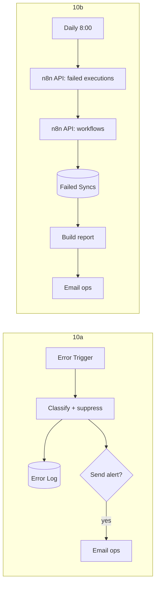

# 10 · Error Handler + Daily Health Report

> Two small workflows that watch the other nine. **10a** catches every failure, explains it in plain English and emails ops without flooding the inbox. **10b** sends a short traffic-light report every morning, which also proves n8n itself is alive.

**Status:** both workflows built and importable; error classification, alert suppression and the health summary covered by 4 unit tests. Not yet run in production.

---

## The business problem

Automations fail quietly. A credential expires, an API runs out of quota, someone renames a sheet column. n8n records a red execution, and nobody looks at executions. The team finds out when a client asks why their lead never got a reply.

The opposite failure is just as bad: during an outage, a basic "email me on every error" setup sends 200 identical emails, and people create a filter that hides them all, including next month's real problem.

## 10a · Error Handler

Set as the **Error Workflow** of projects 01–09 (`deploy.mjs` does this automatically).

1. **Classify** the error ([`classify-error.js`](src/classify-error.js)):

| Category | Matches (examples) | Severity | Likely fix shown in the email |
|---|---|---|---|
| `auth` | 401, 403, "Authorization failed", `invalid_grant`, "token expired" | 🔴 high | Reconnect the credential, re-run the execution |
| `quota` | `insufficient_quota`, "exceeded your current quota", 402 | 🔴 high | Top up or raise the limit |
| `code_bug` | `TypeError`, "Cannot read properties of undefined" | 🔴 high | Fix the Code node / expression |
| `rate_limit` | 429, "too many requests" | 🟠 medium | Usually clears; add batching if it repeats |
| `service_down` | 5xx, `ECONNREFUSED`, `ETIMEDOUT`, "socket hang up" | 🟠 medium | Check the service status; retries catch up |
| `bad_data` | 400, 404, 422, "could not be found", "required" | 🟠 medium | Inspect the failing node's input |
| `unknown` | anything else | 🟠 medium | Open the execution |

2. **Log every error** to the `Error Log` tab (workflow, node, category, message, execution link, whether it was emailed).
3. **Email ops at most once per 30 minutes** per *workflow + node + category*. The next email that goes out says "N similar errors were not emailed". Ten failures in an outage = one email, not ten.

Works for both kinds of failure n8n reports: a failed node in an execution, and a failing trigger (e.g. an IMAP login that stopped working).

## 10b · Daily Health Report

Every day at 8:00:

1. n8n **API**: failed executions (`status=error`) and the workflow list (names, active flag).
2. `Failed Syncs` tab from [project 03](../03-crm-retry-queue): pending rows, oldest age, dead rows.
3. One email:

| Status | When |
|---|---|
| 🟢 | No failed executions, nothing dead |
| 🟡 | 1–4 failed executions |
| 🔴 | 5+ failures, any dead CRM sync, or a pending sync older than 24 h |

With a table of failures per workflow (link to the latest one) and the dead CRM syncs with their error.

### Why both

- 10a reacts to **single** failures; 10b shows the **trend** and **stuck work**.
- If n8n itself is down, no workflow runs, so 10a can never fire. The **missing 8:00 email** is the signal. (For automatic detection, add an external uptime monitor such as UptimeRobot on `/healthz`.)

## Flow



## Node by node

| Workflow | Node | Type | Notes |
|---|---|---|---|
| 10a | On Workflow Error | Error Trigger | Fires only for **production** executions |
| 10a | Classify Error | Code | Rules + suppression state in static data (pruned after 24 h) |
| 10a | Log to Error Log | Google Sheets | Every error |
| 10a | Send Alert? → Email Ops | IF → SMTP | |
| 10b | Every Day 8:00 | Schedule | |
| 10b | n8n API · Failed Executions | HTTP Request | `GET /api/v1/executions?status=error&limit=250` |
| 10b | n8n API · Workflows | HTTP Request | `GET /api/v1/workflows?limit=250` |
| 10b | Read Retry Queue | Google Sheets | Execute once |
| 10b | Build Health Report → Email Health Report | Code → SMTP | [`health-report.js`](src/health-report.js) |

## Setup

1. Credentials: **Google Sheets**, **SMTP**; for 10b a **Header Auth** credential (`X-N8N-API-KEY` = n8n API key from Settings → n8n API) on both API nodes.
2. Tabs `Error Log` and `Failed Syncs`.
3. Deploy with `OPS_EMAIL=...` and, if n8n is not on localhost, `N8N_PUBLIC_URL=...` (used in execution links).
4. Activate both. `deploy.mjs` sets 10a as Error Workflow on all others; in the UI it is *Workflow settings → Error workflow*.

## Try it

- **10a:** activate workflow 01, break it on purpose (e.g. rename the `Leads` tab), submit the form twice. One email arrives with category `bad_data` and a link; `Error Log` has two rows, the second with `alert_sent = false`.
- **10b:** execute it manually; the email lists the failures above.

## Estimated time saved

Not a time-saver so much as **risk reduction**: problems are found in minutes, with a likely fix, instead of days later from a client. Replaces a daily manual check of n8n executions (~10 min/day ≈ **3 hours/month**). *Estimate.*

## Limitations & production notes

- Classification is regex-based. It covers the common cases; new error messages fall into `unknown` until a rule is added (the `Error Log` tab shows which).
- The executions API returns at most 250 per call; above that, follow `nextCursor`.
- Suppression state lives in static data, so it resets if the workflow is re-imported.
- For a team on Slack/Teams, swap the email node; the classification is the reusable part.

## Files

```
workflow.mjs
workflow-error-handler.json   10a
workflow-health-report.json   10b
src/classify-error.js
src/health-report.js
tests/code.test.mjs
```
